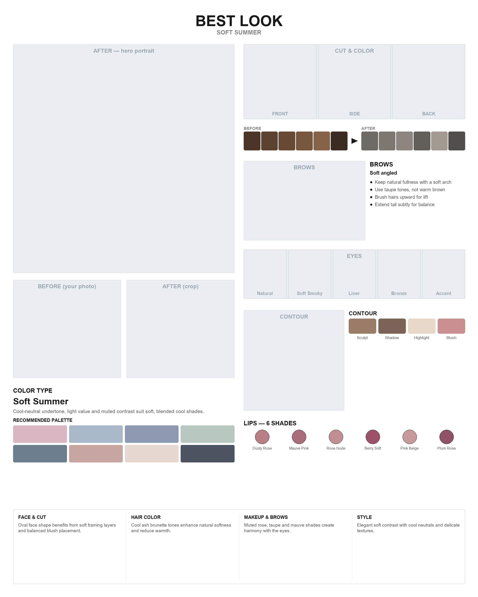

# look-bot

**English** · [Русский](README.ru.md)

A Telegram bot: a person sends a photo of themselves and gets back a 4:5 "BEST LOOK" infographic: color type, palette,
brows, contouring, three views of a haircut and five makeup variants, all on one sheet assembled from generated
fragments of their own face.



## Running it

```
pip install -r requirements.txt
```

Then `python bot/bot.py`. Before that, put the keys into `.env`: kie.ai (the agent and nano-banana), imgbb (hosting
for the reference images) and the Telegram bot token.

To run the pipeline without the bot, on a local file:

```
python tests/run_full.py
```

## Two modes

**Analysis.** A colorist agent looks at the portrait and returns an honest analysis: skin undertone, color type, what
suits the person and what does not. The answer is not free text but JSON under a strict schema (`colorist/schema.py`,
pydantic): fixed list lengths, limits on string length, hex colors. If the model misses the schema, the answer is
rejected and asked for again, otherwise the layout would fall apart.

**Fitting room.** Instead of an honest analysis, a look is taken from the catalog ("I want to look like her"), and
`style_agent` fits that look onto the user's face.

## How the sheet is built

The point is that **the layout is code, not a picture from the model**. The model draws only what it has to: five photo
slots with the face. Headings, palettes, captions, labels and the grid are all drawn in Pillow, so the text is always
sharp, Cyrillic never breaks, and the palette's colors are exactly the ones the agent returned.

`template/build_template.py` is the single source of truth for coordinates. The design canvas is 2048×2560 (4:5),
exported at ×2, 4096×5120. Every frame, crop and slot lives in one coordinate system, so the area generated by
nano-banana is cropped and pasted back into exactly the same pixels. The script writes:

* `template_annotated.png` — a human reference with every slot and its size
* `template_nano_clean.png` — frames only, black on white; this is what goes to the model
* `nano_hair3.png` / `nano_eyes5.png` — separate frames for 3 and 5 cells
* `crops.json` — exact rectangles for cropping and pasting back

Change the layout, run this script again, and the renderer picks up the new coordinates by itself.

```
look-bot/
├── bot/         aiogram: receiving the photo, status, delivering the result
├── colorist/    the agent, the answer schema, assets, montage, progress
├── template/    build_template.py — the layout's coordinates
├── render/      the final drawing of the sheet in Pillow
├── catalog/     the catalog of looks for the fitting room
└── tests/       pipeline runs on fixtures
```

## Progress

Generation takes a while: several model calls in a row. `colorist/progress.py` tracks the status by stage
(analysis → assets → montage) and keeps updating one message in the chat instead of staying silent for three minutes.
`colorist/stats.py` collects the time and cost of each run.
